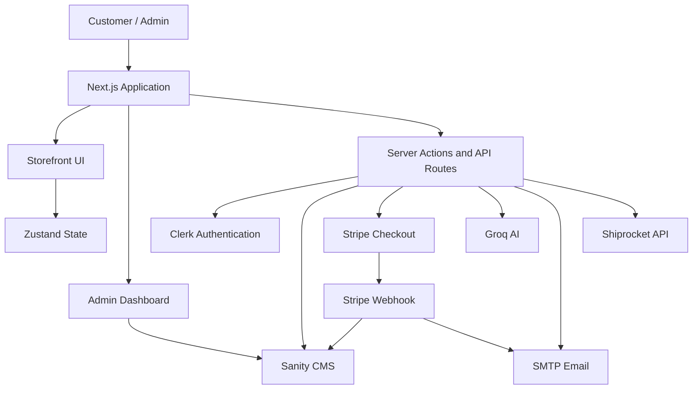
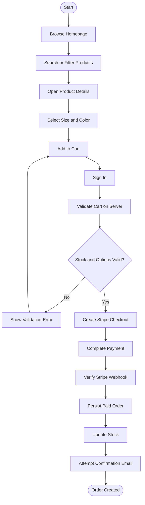

# 👔 Kumar Collection

### ✨ A Modern Ethnic Fashion E-Commerce Platform

**Kumar Collection** is a modern, full-stack clothing e-commerce application built with **Next.js, Sanity CMS, Clerk, Stripe, and Groq AI**. It combines a responsive customer storefront, product and inventory management, secure online payments, order tracking, and an AI-powered shopping assistant.

The current implementation focuses on **men's ethnic wear**, including kurtas, sherwanis, kurta sets, Nehru jackets, festive wear, wedding wear, and ethnic accessories.

> [!NOTE]
> Although the business context also mentions kids' clothing, the active catalog queries, category selectors, Sanity department options, and AI stylist currently support men's categories only. Kids' catalog support is a potential future enhancement.

---

## 📑 Table of Contents

- [🌟 Overview](#-overview)
- [✨ Features](#-features)
- [🛠️ Technology Stack](#️-technology-stack)
- [🏗️ System Architecture](#️-system-architecture)
- [📂 Project Structure](#-project-structure)
- [⚙️ Getting Started](#️-getting-started)
- [🔑 Environment Variables](#-environment-variables)
- [🗃️ Data Model](#️-data-model)
- [🔐 Authentication and Authorization](#-authentication-and-authorization)
- [🛍️ Customer Shopping Workflow](#️-customer-shopping-workflow)
- [📊 Admin Dashboard](#-admin-dashboard)
- [🔌 API Reference](#-api-reference)
- [💳 Payments and Order Management](#-payments-and-order-management)
- [🤖 AI Shopping Assistant](#-ai-shopping-assistant)
- [🚚 Shipping Integration](#-shipping-integration)
- [🚀 Deployment](#-deployment)
- [🧪 Testing and Troubleshooting](#-testing-and-troubleshooting)
- [🛡️ Security and Data Integrity](#️-security-and-data-integrity)
- [📐 System Diagrams](#-system-diagrams)
- [⚠️ Known Limitations](#️-known-limitations)
- [🔮 Future Enhancements](#-future-enhancements)

---

## 🌟 Overview

Kumar Collection brings together modern web technologies to deliver a complete online shopping experience for men's ethnic fashion.

The application provides two primary experiences:

| 🛍️ Customer Storefront                | ⚙️ Administration                     |
| -------------------------------------- | ------------------------------------- |
| Browse and search products             | Manage products and inventory         |
| Filter products by attributes          | Create, edit, and publish products    |
| Select sizes and colors                | Manage homepage banners               |
| Manage cart and wishlist               | View and manage customer orders       |
| Complete secure checkout               | Update order fulfillment status       |
| View personal orders                   | Monitor stock and dashboard insights  |
| Interact with an AI shopping assistant | Review AI-generated business insights |

### 🎯 Project Objectives

- Build a responsive and user-friendly online clothing store.
- Provide reliable product and inventory management.
- Integrate secure authentication and role-based admin access.
- Support online payments and automated order processing.
- Use AI to improve product discovery and shopping assistance.
- Centralize catalog and order data through Sanity CMS.
- Maintain purchase records and order status notification history.

## ✨ Features

### 🛍️ Customer Storefront

- 🏠 **Dynamic Homepage:** Category tiles, featured products, promotional banners, and curated collections.
- 🔎 **Product Search:** Search the catalog and narrow results using multiple filters.
- 🧥 **Ethnic Fashion Catalog:** Kurtas, kurta sets, sherwanis, Nehru jackets, Indo-Western clothing, wedding wear, festive wear, and ethnic accessories.
- 🎨 **Advanced Filtering:** Filter by color, fabric, size, fit, pattern, price, stock availability, and sorting options.
- 🖼️ **Product Details:** Image galleries, descriptions, clothing attributes, stock information, and variant selection.
- 🛒 **Shopping Cart:** Client-side cart management using Zustand.
- ❤️ **Wishlist:** Save favorite products with Sanity-backed persistence for signed-in customers.
- 👤 **Customer Accounts:** Clerk-powered authentication and protected customer pages.
- 📦 **Order History:** Access personal orders and individual order details.
- 📍 **Store Information:** Locate Us and policy information components.
- 📱 **Responsive Design:** Layouts and loading placeholders for different screen sizes.

### ⚙️ Admin and Content Management

- 📊 **Dashboard:** Overview of sales-related data, recent orders, low-stock products, and AI insights.
- 📦 **Inventory Management:** Search, view, create, edit, publish, and manage products.
- 🏷️ **Product Variants:** Configure product sizes and colors.
- 🖼️ **Image Management:** Upload product and banner images to Sanity.
- 📣 **Banner Management:** Configure homepage banners, promotional copy, destinations, ordering, and activation.
- 📝 **Draft Management:** Edit unpublished content and publish or discard drafts.
- 🛍️ **Order Management:** Review order details and update fulfillment status.
- 📧 **Notification History:** Review recorded status-email attempts and retry eligible notifications.
- 📈 **AI Insights:** Generate AI-assisted dashboard insights.
- 🧭 **Sanity Studio:** Manage structured content through the embedded `/studio` interface.

### 💳 Checkout and Payment

- 🔒 Authenticated checkout.
- 💰 Server-side price verification against current Sanity product records.
- 📦 Stock, quantity, size, and color validation.
- 💳 Stripe-hosted Checkout in INR.
- 📍 Shipping address and phone number collection.
- 🔔 Stripe webhook signature verification.
- 🧾 Paid-order persistence in Sanity.
- 🔁 Duplicate-payment protection during webhook retries.
- 📉 Product-level stock decrement after successful order processing.
- 📧 Order confirmation and fulfillment-status emails.

### 🤖 AI-Powered Shopping

- 💬 Conversational shopping assistance.
- 🔎 Tool-based product search using Sanity catalog data.
- 🎯 Recommendations based on product attributes and customer requirements.
- 📦 Authenticated order lookup through an AI tool.
- 📊 Separate AI-generated admin insights.
- ⚡ Streaming responses through the Vercel AI SDK and Groq provider.

### 🚚 Delivery Assistance

- 📮 Six-digit Indian pincode validation.
- 🚛 Shiprocket serviceability checks.
- ⏱️ Delivery availability and estimate responses when supplied by the service.
- ⚡ In-process caching and request limiting.

---

## 🛠️ Technology Stack

The project uses a modern TypeScript-based stack with a headless CMS, managed authentication, hosted payments, and AI integration.

| Technology    | Version    | Purpose                                                  |
| ------------- | ---------- | -------------------------------------------------------- |
| Next.js       | `16.0.7`   | App Router, server rendering, server actions, API routes |
| React         | `19.2.3`   | Component-based user interface                           |
| TypeScript    | `^5`       | Type safety and maintainable application code            |
| Sanity        | `^4.20.3`  | Headless CMS and persistent content                      |
| next-sanity   | `^11.6.10` | Sanity integration with Next.js                          |
| Clerk         | `^6.36.0`  | Authentication and session management                    |
| Stripe SDK    | `^20.0.0`  | Checkout sessions and payment processing                 |
| Vercel AI SDK | `^6.0.39`  | AI agent and streaming workflows                         |
| Groq Provider | `^3.0.10`  | AI model integration                                     |
| Zustand       | `^5.0.9`   | Client-side cart, wishlist, and chat state               |
| Tailwind CSS  | `^4`       | Utility-first styling                                    |
| Nodemailer    | `^10.0.16` | SMTP email integration                                   |
| Zod           | `^4.1.13`  | Request and input validation                             |
| Biome         | `2.2.0`    | Code checks and formatting                               |

Additional libraries include Radix UI, Embla Carousel, Lucide React, Styled Components, Next Themes, and React Markdown.

> **Runtime requirement:** Use Node.js 20.9 or later as a baseline compatible with Next.js 16. Prefer a current supported Node.js LTS release and verify the requirements for the exact deployment environment.

### 🧩 Why These Technologies?

- **Next.js:** Combines storefront pages, server-side operations, and API handlers in one application.
- **Sanity:** Provides structured catalog, order, banner, and customer-related documents.
- **Clerk:** Handles sign-in and supports separate customer authentication and admin authorization.
- **Stripe:** Provides hosted checkout and payment event processing.
- **Groq:** Powers conversational shopping assistance and dashboard insights.
- **Zustand:** Manages interactive client-side shopping state.
- **Tailwind CSS:** Supports responsive styling and consistent UI development.

---

## 🏗️ System Architecture

The application follows a full-stack, server-rendered architecture with a headless content platform and external service integrations.



### 🔄 Architecture Flow

1. The browser renders storefront or admin pages through Next.js.
2. Server components and server actions retrieve catalog data and prepare checkout operations.
3. Zustand maintains client-side shopping state.
4. Clerk identifies authenticated users and protects relevant routes.
5. Admin operations perform a separate role check.
6. Sanity stores products, categories, banners, orders, and related records.
7. Stripe handles hosted checkout and sends signed webhook events.
8. Groq powers AI requests, Nodemailer sends emails, and Shiprocket checks delivery serviceability.

**Architecture principles**

- Server-side validation for checkout.
- Separation of authentication and authorization.
- Structured content management through Sanity.
- Hosted payment collection through Stripe.
- Reusable UI components and server-side integrations.
- Purchase-time snapshots for historical order details.

---

## 📂 Project Structure

The following is a simplified map of the repository's main directories.

```text
kumar-collection/
│
├── app/
│   ├── (app)/                    # Storefront, products, checkout, orders
│   ├── (admin)/admin/            # Admin dashboard and management pages
│   ├── api/
│   │   ├── admin/                # Admin content, orders, insights
│   │   ├── chat/                 # AI shopping assistant
│   │   ├── wishlist/             # Wishlist operations
│   │   ├── shipping/             # Pincode serviceability
│   │   └── webhooks/stripe/       # Stripe webhook
│   ├── sign-in/                  # Clerk sign-in page
│   └── studio/                   # Embedded Sanity Studio
│
├── components/
│   ├── app/                      # Storefront components
│   ├── admin/                    # Admin interface components
│   └── ui/                       # Shared UI primitives
│
├── lib/
│   ├── actions/                  # Checkout and order actions
│   ├── ai/                       # AI agent and tools
│   ├── auth/                     # Admin authorization
│   ├── email/                    # Email templates and sender
│   ├── sanity/                   # Queries and admin client
│   └── store/                    # Zustand stores
│
├── sanity/
│   ├── schemaTypes/              # Sanity document schemas
│   ├── lib/                      # Clients, images, live helpers
│   └── structure.ts              # Studio navigation
│
├── scripts/                      # Catalog preparation and checks
├── docs/
│   ├── diagrams/                 # Mermaid source diagrams
│   └── project-report-diagrams/  # Report-ready diagram assets
│
├── proxy.ts                      # Request protection and routing
├── sanity.config.ts              # Sanity Studio configuration
├── sanity.cli.ts                 # Sanity CLI configuration
├── next.config.ts                # Next.js configuration
├── package.json                  # Scripts and dependencies
├── package-lock.json             # Locked npm dependency tree
├── tsconfig.json                 # TypeScript configuration
└── README.md
```

---

## ⚙️ Getting Started

Follow these steps to run Kumar Collection locally.

### 📋 Prerequisites

Install or configure the following:

- [Node.js](https://nodejs.org/) compatible with Next.js 16.
- [npm](https://www.npmjs.com/).
- A Sanity project and dataset.
- Clerk application credentials.
- Stripe credentials for checkout testing.
- A Groq API key for AI features.
- SMTP credentials for email features.
- Shiprocket credentials for delivery checks.

Some integrations are optional when working only on the storefront.

### 1️⃣ Clone the Repository

```bash
git clone <YOUR_REPOSITORY_URL>
cd <YOUR_PROJECT_DIRECTORY>
```

Replace the placeholders with your actual repository URL and directory name.

### 2️⃣ Install Dependencies

```bash
npm ci
```

This installs the dependency versions recorded in `package-lock.json`.

### 3️⃣ Configure Environment Variables

Create a `.env.local` file in the project root and add the credentials required for the features you want to run.

See [Environment Variables](#-environment-variables) for the complete reference.

### 4️⃣ Start the Development Server

```bash
npm run dev
```

Open [http://localhost:3000](http://localhost:3000) in your browser.

### 5️⃣ Run Project Checks

```bash
npm run lint
npm run typecheck
npm run build
```

To start the production build locally after a successful build:

```bash
npm run start
```

### 📜 Available npm Scripts

| Command                          | Purpose                           |
| -------------------------------- | --------------------------------- |
| `npm run dev`                    | Start the development server      |
| `npm run build`                  | Build the application             |
| `npm run start`                  | Start the production server       |
| `npm run lint`                   | Run configured code checks        |
| `npm run typecheck`              | Check TypeScript types            |
| `npm run typegen`                | Generate configured types         |
| `npm run sanity:seed-categories` | Seed category documents in Sanity |

> [!CAUTION]
> The category seed script writes to Sanity. Check the configured project and dataset before running it. Catalog preparation and verification scripts under `scripts/` are standalone `.mjs` files and may have their own data or file-writing side effects.

---

## 🔑 Environment Variables

Create `.env.local` in the repository root.

### 🗃️ Sanity CMS

| Variable                         | Purpose                                                |
| -------------------------------- | ------------------------------------------------------ |
| `NEXT_PUBLIC_SANITY_PROJECT_ID`  | Sanity project identifier                              |
| `NEXT_PUBLIC_SANITY_DATASET`     | Dataset used by the application                        |
| `NEXT_PUBLIC_SANITY_API_VERSION` | Optional API version override; default is `2025-12-05` |
| `NEXT_PUBLIC_SANITY_ORG_ID`      | Optional Sanity CLI organization configuration         |
| `SANITY_API_WRITE_TOKEN`         | Server-side wishlist/order writes and scripts          |
| `SANITY_ADMIN_API_TOKEN`         | Admin content operations and image uploads             |

### 🔐 Clerk Authentication

| Variable                            | Purpose                          |
| ----------------------------------- | -------------------------------- |
| `NEXT_PUBLIC_CLERK_PUBLISHABLE_KEY` | Client-side Clerk configuration  |
| `CLERK_SECRET_KEY`                  | Server-side Clerk authentication |

### 💳 Stripe Payments

| Variable                | Purpose                                         |
| ----------------------- | ----------------------------------------------- |
| `STRIPE_SECRET_KEY`     | Create Checkout sessions and access Stripe APIs |
| `STRIPE_WEBHOOK_SECRET` | Verify incoming webhook signatures              |

### 🤖 AI Integration

| Variable       | Purpose                          |
| -------------- | -------------------------------- |
| `GROQ_API_KEY` | Authenticate AI requests to Groq |

### 📧 Email Configuration

| Variable          | Purpose                                |
| ----------------- | -------------------------------------- |
| `SMTP_HOST`       | SMTP server hostname                   |
| `SMTP_PORT`       | SMTP server port                       |
| `SMTP_SECURE`     | SMTP transport security setting        |
| `SMTP_USER`       | SMTP authentication username           |
| `SMTP_PASS`       | SMTP authentication password           |
| `SMTP_FROM_EMAIL` | Sender email address                   |
| `SITE_URL`        | Canonical site URL used in email links |

### 🚚 Shipping Configuration

| Variable                              | Purpose                        |
| ------------------------------------- | ------------------------------ |
| `SHIPROCKET_EMAIL`                    | Shiprocket account email       |
| `SHIPROCKET_PASSWORD`                 | Shiprocket account password    |
| `SHIPROCKET_PICKUP_PINCODE`           | Shipment origin pincode        |
| `SHIPROCKET_SERVICEABILITY_WEIGHT_KG` | Representative shipment weight |

### 🌐 Store and Checkout URLs

| Variable                           | Purpose                               |
| ---------------------------------- | ------------------------------------- |
| `NEXT_PUBLIC_BASE_URL`             | Optional checkout return URL override |
| `NEXT_PUBLIC_TRACK_ORDER_URL`      | Optional external tracking URL        |
| `NEXT_PUBLIC_STORE_ADDRESS`        | Public store address                  |
| `NEXT_PUBLIC_STORE_MAP_EMBED_URL`  | Optional map embed URL                |
| `NEXT_PUBLIC_STORE_DIRECTIONS_URL` | Optional directions link              |

### 🔒 Example Configuration

Use placeholder values only. Replace them with the appropriate credentials in your local environment.

```dotenv
# Sanity
NEXT_PUBLIC_SANITY_PROJECT_ID=your_project_id
NEXT_PUBLIC_SANITY_DATASET=production
NEXT_PUBLIC_SANITY_API_VERSION=2025-12-05

SANITY_API_WRITE_TOKEN=your_write_token
SANITY_ADMIN_API_TOKEN=your_admin_token

# Clerk
NEXT_PUBLIC_CLERK_PUBLISHABLE_KEY=your_publishable_key
CLERK_SECRET_KEY=your_clerk_secret

# Stripe
STRIPE_SECRET_KEY=your_stripe_secret
STRIPE_WEBHOOK_SECRET=your_webhook_secret

# AI
GROQ_API_KEY=your_groq_api_key

# Email
SMTP_HOST=your_smtp_host
SMTP_PORT=587
SMTP_SECURE=false
SMTP_USER=your_smtp_username
SMTP_PASS=your_smtp_password
SMTP_FROM_EMAIL=your_sender_email
SITE_URL=http://localhost:3000

# Shipping
SHIPROCKET_EMAIL=your_shiprocket_email
SHIPROCKET_PASSWORD=your_shiprocket_password
SHIPROCKET_PICKUP_PINCODE=your_pickup_pincode
SHIPROCKET_SERVICEABILITY_WEIGHT_KG=1
```

This is a starter template, not a guarantee that every integration will work with only these values. Configure the remaining URL variables when needed.

> [!WARNING]
> Never commit `.env.local`, expose server-side secrets through `NEXT_PUBLIC_` variables, or include real credentials in screenshots, reports, issues, or logs. The `.env.example` file documents only part of the complete environment configuration, so use this reference alongside the actual source code.

---

## 🗃️ Data Model

Sanity stores data as documents. Relationships use references or embedded fields rather than traditional relational database foreign keys.

| Document                  | Important Fields                                                                                                   | Purpose                              |
| ------------------------- | ------------------------------------------------------------------------------------------------------------------ | ------------------------------------ |
| `product`                 | Name, slug, description, INR price, category, gender, fabric, fit, pattern, colors, sizes, images, stock, featured | Product catalog                      |
| `category`                | Title, slug, department, image                                                                                     | Category and department organization |
| `banner`                  | Image, copy, CTA, destination, category/product reference, active state, display order                             | Homepage promotions                  |
| `customer`                | Email, name, Clerk user ID, Stripe customer ID, creation date                                                      | Customer-related records             |
| `order`                   | Order number, items, total, payment status, fulfillment status, customer details, payment ID, creation date        | Purchase records                     |
| `wishlist`                | Clerk user ID, product references                                                                                  | Saved products                       |
| `orderStatusNotification` | Order reference, status transition, delivery state, attempts, timestamps, sanitized error code                     | Email notification history           |

### 📦 Product Variants

A product stores size and color options as arrays. Inventory is tracked at the product level rather than separately for every size/color combination.

Order items preserve purchase-time details such as:

- Product reference.
- Quantity.
- `priceAtPurchase`.
- Selected size.
- Selected color.

### 📝 Drafts and Publishing

Product and banner editing supports Sanity drafts.

- **Create or edit:** Work with draft documents.
- **Publish:** Promote the draft to published content.
- **Discard:** Remove an unpublished draft.
- **Delete:** Product deletion is refused when an order references the product.

Purchase-time snapshots help preserve historical order details when a product is edited later.

---

## 🔐 Authentication and Authorization

Kumar Collection uses Clerk for customer identity and admin access control.

### 👤 Customer Authentication

- Customers sign in through Clerk.
- Checkout and order pages require an authenticated session.
- Customer wishlist operations use the signed-in user's identity.
- Customer-specific data should always be scoped to the authenticated user.

### 🛡️ Admin Authorization

Admin access uses a separate role check in `lib/auth/admin.ts`.

The implementation checks:

```ts
publicMetadata.role === "admin"
```

Admin API routes use this helper to authorize sensitive operations.

**Important security rules:**

1. Authentication identifies the user; authorization determines what the user may do.
2. Never accept an admin role directly from browser form data.
3. Assign admin metadata through a trusted Clerk dashboard or backend process.
4. Verify per-user ownership on customer-specific API operations.
5. Configure Sanity Studio access and permissions independently.

> [!IMPORTANT]
> Clerk middleware protects the documented `/admin`, `/checkout`, `/orders`, and `/checkout/success` paths. The `/studio` route is not established as protected by the documented Clerk matcher. Configure Studio access and Sanity permissions explicitly.

---

## 🛍️ Customer Shopping Workflow

The normal customer journey follows these steps.



### 🔄 Workflow Explanation

1. **Discover:** Browse published products and categories.
2. **Select:** View product details and choose available size/color options.
3. **Add to cart:** Zustand stores the current cart in client-side state.
4. **Validate:** The server reloads product records from Sanity and validates current price, availability, and selected options.
5. **Checkout:** The server creates a Stripe Checkout session for the authenticated customer.
6. **Payment:** The customer completes payment through Stripe.
7. **Order persistence:** The webhook verifies the Stripe signature and checks payment status.
8. **Stock update:** The order-processing handler decrements product-level stock.
9. **Confirmation:** The application attempts to send an order confirmation email.

---

## 📊 Admin Dashboard

The admin dashboard provides tools for managing the store's catalog, orders, and homepage content.

| Route                   | Functionality                                                               |
| ----------------------- | --------------------------------------------------------------------------- |
| `/admin`                | Dashboard statistics, recent orders, low-stock information, and AI insights |
| `/admin/inventory`      | Product and inventory listing                                               |
| `/admin/inventory/[id]` | Product editing and publishing                                              |
| `/admin/orders`         | Order search and status overview                                            |
| `/admin/orders/[id]`    | Order details, address editing, fulfillment updates, notification history   |
| `/admin/banners`        | Banner content, images, destinations, ordering, and activation              |

### 🧾 Product Management

Authorized administrators can create and edit product drafts, manage supported fields, upload images, publish content, and manage product availability.

### 📣 Banner Management

Homepage banners support:

- Promotional images and text.
- Calls to action.
- Product/category references or custom URLs.
- Active/inactive state.
- Display ordering.

The homepage supports up to eight active, ordered banners.

### 📦 Order Fulfillment

Administrators can update allowed fulfillment transitions, inspect notification history, and retry eligible notification attempts.

Image uploads pass through the admin API and are limited to image MIME types and 4 MB.

---

## 🔌 API Reference

The following table summarizes the documented application routes.

| Method               | Endpoint                                                             | Description                                                      | Access                                     |
| -------------------- | -------------------------------------------------------------------- | ---------------------------------------------------------------- | ------------------------------------------ |
| `POST`               | `/api/webhooks/stripe`                                               | Process Stripe Checkout completion events                        | Stripe signature verification              |
| `GET`, `POST`, `PUT` | `/api/admin/content`                                                 | Read, create, edit, publish, discard, delete, and upload content | Admin                                      |
| `POST`               | `/api/admin/orders/{id}/fulfillment-status`                          | Update fulfillment status                                        | Admin                                      |
| `PATCH`              | `/api/admin/orders/{id}/fulfillment-status`                          | Validate and apply an allowed status transition                  | Admin                                      |
| `GET`                | `/api/admin/orders/{id}/status-notifications`                        | Retrieve notification state                                      | Admin                                      |
| `POST`               | `/api/admin/orders/{id}/status-notifications/{notificationId}/retry` | Retry a recorded notification                                    | Admin                                      |
| `GET`                | `/api/admin/insights`                                                | Generate dashboard insights                                      | Admin                                      |
| `GET`, `POST`        | `/api/wishlist`                                                      | Read or modify the signed-in user's wishlist                     | Authenticated customer                     |
| `POST`               | `/api/chat`                                                          | Stream AI shopping assistant responses                           | Public; order tool requires authentication |
| `POST`               | `/api/shipping/check-pincode`                                        | Check pincode serviceability                                     | Public, rate-limited                       |

### 🔑 API Access Rules

- **Admin APIs:** Require a Clerk session with `publicMetadata.role = "admin"`.
- **Wishlist APIs:** Require an authenticated user; writes need the appropriate Sanity write token.
- **Stripe webhook:** Requires a valid Stripe signature.
- **AI chat:** Guests can search products, while authenticated sessions also receive the order lookup tool.
- **Shipping API:** Publicly accessible with input validation and in-process request limiting.

Checkout session creation and order-session retrieval are implemented as server actions rather than public REST endpoints.

> **Note:** The two fulfillment-status methods serve distinct operations in the documented implementation. Verify the actual route handler before changing request methods or request body formats.

---

## 💳 Payments and Order Management

Stripe provides hosted checkout and payment event processing.

### 💰 Checkout Process

1. The customer initiates checkout.
2. The server verifies the Clerk session.
3. Product records are reloaded from Sanity.
4. The server validates prices, stock, quantities, and selected variants.
5. A Stripe Checkout session is created in INR.
6. Stripe collects the payment and configured customer shipping details.

### 🔔 Webhook Processing

The webhook handles:

- `checkout.session.completed`
- `checkout.session.async_payment_succeeded`

The handler verifies the signature, skips unpaid sessions, checks for an existing order using the payment ID, persists the paid order, decrements stock, and attempts confirmation email delivery.

If processing fails, the handler returns an error status so Stripe can retry the event.

### 📧 Email Notifications

SMTP is used for:

- Order confirmation emails.
- Fulfillment-status notifications.

Notification attempts are recorded in Sanity, and eligible failed or uncertain notifications can be retried.

Email delivery depends on valid SMTP configuration, a usable sender address, and the correct site URL. SMTP acceptance does not guarantee final delivery to the recipient's inbox.

---

## 🤖 AI Shopping Assistant

The customer shopping assistant uses the Vercel AI SDK's `ToolLoopAgent` with the `@ai-sdk/groq` provider.

**Configured model:** `openai/gpt-oss-120b`

### 🛍️ Product Search

The `searchProducts` tool queries Sanity using supported catalog filters, including:

- Category.
- Color.
- Fabric.
- Gender.
- Size.
- Fit.
- Pattern.
- Price.
- Text search.

The current assistant instructions limit recommendations to men's ethnic clothing.

### 📦 Customer Order Lookup

Authenticated users receive access to the `getMyOrders` tool. Guests can use product-search assistance but do not receive this order lookup tool.

Order lookup must remain scoped to the authenticated customer.

### 📊 Admin AI Insights

The separate `/api/admin/insights` endpoint generates AI-assisted dashboard insights and requires admin authorization.

### ⚠️ AI Limitations

- Recommendations depend on the current catalog and provider availability.
- AI responses do not reserve inventory.
- Product availability must be verified against current server-side data.
- AI-generated business insights should be reviewed before making important operational decisions.

---

## 🚚 Shipping Integration

The application integrates with Shiprocket to check pincode serviceability.

### 📮 Pincode Check Workflow

1. The customer enters a six-digit pincode.
2. The application validates the input.
3. The server checks serviceability through Shiprocket.
4. The response indicates availability and any returned delivery estimate.
5. The application may reuse cached results for subsequent requests.

### ⚡ Caching and Rate Limiting

The current implementation uses in-process memory for token/result caching and request limiting.

This can reduce repeated API calls, but it is not shared across serverless instances and may reset when an instance restarts.

---

## 🚀 Deployment

Kumar Collection is a Next.js application suitable for deployment on Vercel.

### 1️⃣ Prepare the Application

Run the checks locally:

```bash
npm ci
npm run lint
npm run typecheck
npm run build
```

Resolve any build or type errors before deployment.

### 2️⃣ Configure Production Environment Variables

In your deployment provider, configure the credentials and settings required by each enabled integration:

- Sanity project, dataset, and appropriately scoped tokens.
- Clerk production keys and application origins.
- Stripe secret key and webhook signing secret.
- Groq API key.
- SMTP configuration.
- Shiprocket credentials and shipping settings, if enabled.
- Canonical storefront URL and other public URL settings.

### 3️⃣ Deploy to Vercel

1. Import the Git repository into Vercel.
2. Configure the environment variables.
3. Confirm the framework and build settings.
4. Deploy the application.
5. Verify the production build and public storefront.

A separate `vercel.json` is not present in the documented repository; standard Next.js deployment support may be sufficient.

### 4️⃣ Configure the Stripe Webhook

Configure the Stripe webhook destination as:

```text
https://<production-host>/api/webhooks/stripe
```

Enable the event types handled by the application:

```text
checkout.session.completed
checkout.session.async_payment_succeeded
```

Use the signing secret generated for the configured webhook endpoint.

### 5️⃣ Verify Production

- [ ] Homepage and category pages load correctly.
- [ ] Product images display correctly.
- [ ] Clerk sign-in works.
- [ ] Admin role checks reject unauthorized users.
- [ ] Product drafts can be published.
- [ ] Cart and checkout validate current stock and prices.
- [ ] Stripe test payment and webhook processing work.
- [ ] Orders are created without duplicate payment records.
- [ ] Confirmation and status emails are configured.
- [ ] AI shopping chat and admin insights work.
- [ ] Shiprocket pincode checks return expected responses.
- [ ] Customer order and wishlist access is properly scoped.

Use Stripe test mode and test data while validating payment flows.

---

## 🧪 Testing and Troubleshooting

The repository includes build, lint, typecheck, and standalone catalog verification scripts. A dedicated automated test suite was not identified in the documented implementation.

### 🧪 Recommended Validation Checklist

| Area           | What to Verify                                              |
| -------------- | ----------------------------------------------------------- |
| Storefront     | Homepage, navigation, category pages, product images        |
| Catalog        | Search, filters, sorting, sizes, colors, stock              |
| Authentication | Clerk sign-in and protected pages                           |
| Authorization  | Customer/admin separation and admin role checks             |
| Inventory      | Product drafts, publishing, editing, stock changes          |
| Banners        | Image uploads, destinations, active state, ordering         |
| Cart           | Quantity changes and current-price validation               |
| Checkout       | Stock validation, payment, shipping details                 |
| Webhook        | Signature verification, duplicate events, order persistence |
| Email          | Confirmation, status changes, retry handling                |
| AI             | Product search, guest access, authenticated order lookup    |
| Shipping       | Pincode validation and serviceability responses             |
| Deployment     | Production build, environment configuration, type checks    |

### 🔧 Verification Scripts

Two documented scripts are available:

- `scripts/verify-local-storefront.mjs`: Performs HTTP checks against a running storefront and updates a review Markdown file.
- `scripts/verify-kumar-storefront.mjs`: Queries Sanity and updates `generated-kumar-catalog-review.md`.

Inspect each script's target URL, configured dataset, and file-writing behavior before executing it.

### 🛠️ Common Problems

| Problem                       | Possible Cause                                     | Suggested Check                                         |
| ----------------------------- | -------------------------------------------------- | ------------------------------------------------------- |
| Sanity pages fail             | Missing project ID or dataset                      | Verify Sanity environment settings                      |
| Admin content operations fail | Missing or invalid admin token                     | Check the admin token and Sanity permissions            |
| Checkout cannot start         | Missing Stripe credentials or invalid cart data    | Check Stripe configuration and server validation errors |
| Webhook returns an error      | Invalid signature or processing failure            | Verify endpoint secret and Stripe event logs            |
| Email fails                   | Incomplete SMTP configuration                      | Check host, port, authentication, and sender            |
| AI assistant fails            | Missing Groq key or provider issue                 | Check server-side configuration and provider status     |
| Pincode check is unavailable  | Missing Shiprocket configuration or provider issue | Verify credentials and shipping settings                |
| Images do not load            | Invalid asset references or configuration          | Inspect Sanity image data and image settings            |
| Build fails                   | Type errors or incompatible dependencies           | Run lint, typecheck, and build separately               |

> [!TIP]
> Start troubleshooting by checking sanitized application errors and the relevant provider dashboard. Never print real credentials or tokens while debugging.

---

## 🛡️ Security and Data Integrity

Security and accurate order processing are essential for an e-commerce application.

### 🔐 Credential Protection

- Keep Clerk secrets, Stripe keys, webhook secrets, Sanity write tokens, Groq keys, SMTP credentials, and Shiprocket credentials on the server.
- Never commit `.env.local`.
- Use separate, appropriately scoped tokens for different operations.
- Do not expose privileged Sanity clients to browser code.

### 💳 Payment Integrity

- Verify Stripe webhook signatures using the configured signing secret.
- Validate product prices, stock, and selected options on the server.
- Do not trust client-submitted prices or totals.
- Check existing payment IDs before creating duplicate orders.

### 📦 Order Integrity

- Preserve purchase-time prices and selected variants in order items.
- Protect historical product references when deleting catalog entries.
- Restrict order lookups and updates to authorized users.
- Review stock updates for concurrent purchases and webhook retry behavior.

### 🛡️ Admin Protection

- Enforce admin authorization on sensitive API routes.
- Validate mutation inputs and restrict editable fields.
- Validate image MIME types and upload sizes.
- Configure Sanity Studio access separately from storefront authentication.

### ⚠️ Areas Requiring Further Review

- Per-user ownership checks for every customer-specific API operation.
- Atomic or concurrency-safe inventory decrementing.
- Cross-instance rate limiting and shared caching.
- Automated tests for payment retries and simultaneous stock updates.
- Production monitoring for webhook, email, and provider failures.

---

## 📐 System Diagrams

The repository contains Mermaid source diagrams and report-ready diagram assets.

| Resource                                                                           | Description                                          |
| ---------------------------------------------------------------------------------- | ---------------------------------------------------- |
| [`docs/diagrams/README.md`](docs/diagrams/README.md)                               | Diagram index, report placement, and export guidance |
| [`docs/diagrams/09-deployment-diagram.md`](docs/diagrams/09-deployment-diagram.md) | Deployment architecture                              |
| [`docs/diagrams/03-system-flowchart.md`](docs/diagrams/03-system-flowchart.md)     | System workflow                                      |
| [`docs/diagrams/gantt-chart.md`](docs/diagrams/gantt-chart.md)                     | Retrospective development timeline                   |
| [`docs/project-report-diagrams/README.md`](docs/project-report-diagrams/README.md) | Print-ready diagram assets and Word report guidance  |

Mermaid source files can be edited to update diagrams as the implementation evolves.

---

## ⚠️ Known Limitations

The following limitations reflect the currently documented implementation.

- **Men's catalog only:** Kids' clothing is not represented in active category selectors, catalog queries, department options, or AI recommendations.
- **Product-level inventory:** Sizes and colors are options on a product, not independently stocked SKU documents.
- **Client-side cart:** Cart state is maintained in the browser; a durable server-side cart is not implemented.
- **In-process cache:** Shiprocket caching and request limiting are not shared across serverless instances.
- **Email delivery visibility:** The application records notification attempts and integration outcomes, not final inbox delivery.
- **Automated testing:** No dedicated automated test suite was identified.
- **Runtime pinning:** A root Node.js version pin was not identified.
- **Studio access:** The documented Clerk matcher does not establish protection for `/studio`.
- **Authorization review:** Customer-specific API ownership checks should be reviewed before expanding access.
- **Inventory concurrency:** Stock decrementing should be evaluated under concurrent checkout and webhook retry conditions.

---

## 🔮 Future Enhancements

The following improvements may be considered based on business requirements.

- 👕 **Kids' Clothing Catalog:** Add kids' departments, categories, product queries, banner selectors, and AI support.
- 🎨 **Variant-Level Inventory:** Track stock independently for each size and color combination.
- 🛒 **Persistent Shopping Cart:** Synchronize cart contents across devices for signed-in customers.
- ⚡ **Shared Rate Limiting:** Use shared infrastructure for request limiting and delivery-result caching.
- 🧪 **Automated Test Coverage:** Add unit, integration, and end-to-end tests for shopping and payment workflows.
- 📦 **Inventory Concurrency Protection:** Make stock updates safe under simultaneous purchases and webhook retries.
- 📊 **Advanced Analytics:** Add deeper sales, product performance, and inventory reporting.
- 🔔 **Improved Monitoring:** Track failed webhooks, notification retries, and external service availability.
- 🔐 **Security Hardening:** Add systematic authorization tests and strengthen customer-data access controls.

These are potential enhancements, not features claimed to be implemented.

---

## 👔 About Kumar Collection

Kumar Collection is designed to bring a modern online shopping experience to ethnic fashion through a responsive storefront, structured content management, secure checkout, order administration, and AI-assisted product discovery.

**Built with Next.js, TypeScript, Sanity, Clerk, Stripe, and Groq AI.**

⭐ If you find the project useful, consider giving the repository a star.

---

