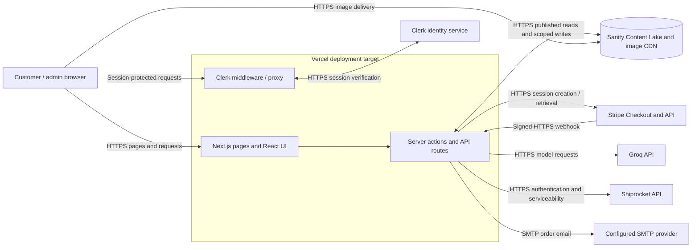

# Deployment topology

The repository uses Next.js App Router and documents Vercel-oriented deployment configuration. This diagram describes the configured architecture, not a verified live deployment. External integrations are included where code references the provider.

**Caption:** Browser, hosting/runtime boundary, and confirmed integrations. Runtime configuration names referenced by the code include `NEXT_PUBLIC_SANITY_PROJECT_ID`, `NEXT_PUBLIC_SANITY_DATASET`, `NEXT_PUBLIC_SANITY_API_VERSION`, `SANITY_API_WRITE_TOKEN`, `SANITY_ADMIN_API_TOKEN`, `NEXT_PUBLIC_CLERK_PUBLISHABLE_KEY`, `CLERK_SECRET_KEY`, `STRIPE_SECRET_KEY`, `STRIPE_WEBHOOK_SECRET`, `NEXT_PUBLIC_BASE_URL`, `SITE_URL`, `GROQ_API_KEY`, `SHIPROCKET_EMAIL`, `SHIPROCKET_PASSWORD`, `SHIPROCKET_PICKUP_PINCODE`, `SHIPROCKET_SERVICEABILITY_WEIGHT_KG`, `SMTP_HOST`, `SMTP_PORT`, `SMTP_USER`, `SMTP_PASS`, and `SMTP_FROM_EMAIL`. Values are intentionally omitted. Other optional public store/map settings are documented in `.env.example`. The source configuration alone does not establish that a current production deployment is serving traffic. A4 landscape recommended.
