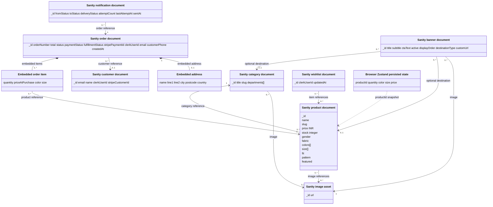

# Domain model

Persisted Sanity documents are shown as documents. Order items and addresses are embedded values; cart state is browser storage. There is no separate product-variant entity.

**Caption:** Main business documents and embedded values. Clerk and Stripe are external services; their identities are represented by fields rather than local service-owned entities. Image values point to Sanity assets.
