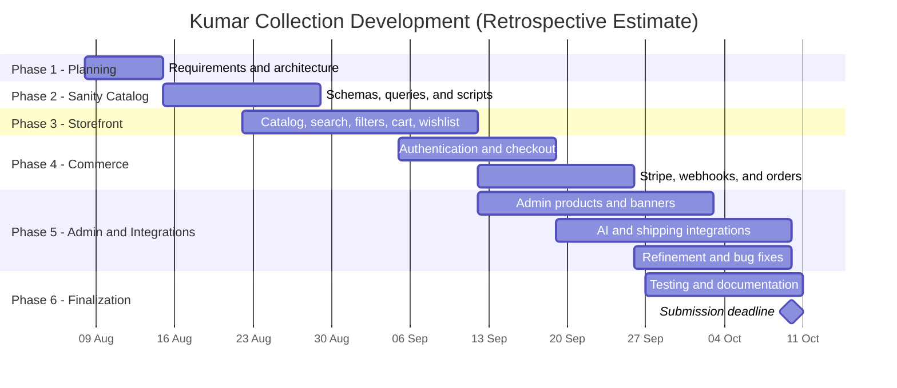

# Estimated Development Phases

**Retrospective Estimate:** The dates below are plausible estimates based on the project scope and submission deadline. They are not verified historical records. Feature inclusion reflects repository evidence and does not certify when or whether production deployment occurred.

| Phase | Estimated duration / dates | Main activities |
|---|---|---|
| Phase 1 | 1 week · 8–14 Aug 2026 | Requirements, project scope, architecture, and data model planning |
| Phase 2 | 2 weeks · 15–28 Aug 2026 | Sanity schemas, catalog queries, seed scripts, and category setup |
| Phase 3 | 3 weeks · 22 Aug–11 Sep 2026 | Storefront, product catalog, search, filters, cart, and wishlist |
| Phase 4 | 3 weeks · 5–25 Sep 2026 | Clerk authentication, checkout validation, Stripe integration, webhook, and orders |
| Phase 5 | 4 weeks · 12 Sep–9 Oct 2026 | Admin dashboard, product and banner management, notifications, AI features, shipping serviceability, and iterative fixes |
| Phase 6 | 2 weeks · 27 Sep–10 Oct 2026 | Testing, bug fixes, configuration review, diagram preparation, documentation, and final submission |

## Gantt Chart

**Project Management Approach:** The development schedule uses overlapping phases to fit the project into the available period. Initial planning is followed by catalog and database setup. Storefront development begins while catalog work is in progress. Authentication, checkout, and order processing are developed after the core shopping flow is established. Admin tools and external integrations are implemented alongside commerce work. Testing, bug fixing, diagram preparation, and report writing continue during the final two weeks.

All dates and durations are retrospective planning estimates, not verified historical records. Actual feature implementation and deployment status must be checked against repository evidence.