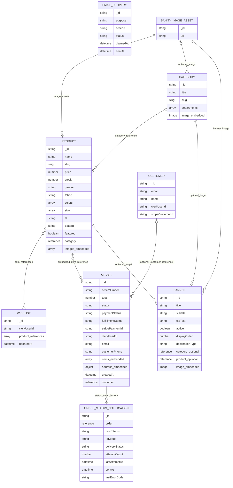

# Sanity document relationship / ER diagram

Sanity is a document database. This diagram shows schema documents, embedded objects, and references; the connectors do not imply SQL foreign keys.

**Caption:** Current Sanity schema graph. Image fields and order item/address values are embedded; image assets and referenced documents are separate Sanity documents. `emailDelivery` is created by the confirmation-email claim logic, although it is not registered as a Studio schema type. A4 landscape recommended.
