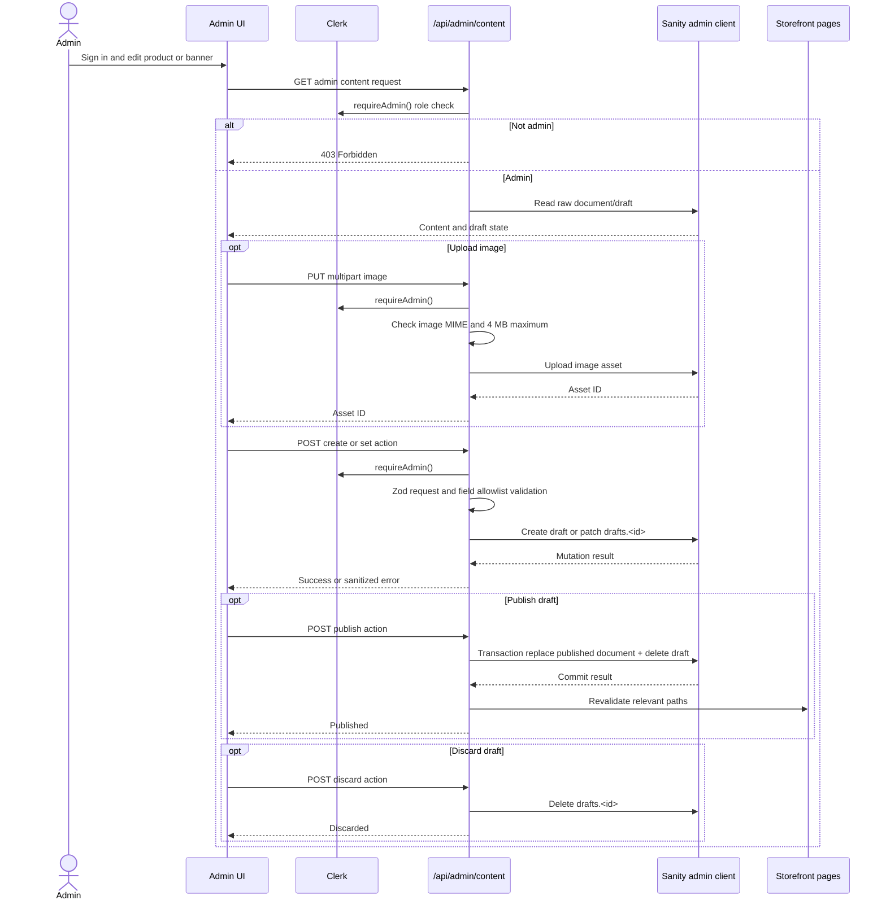

# Sequence B — admin product and banner management

The admin content API is shared by inventory/product and banner screens. Product and banner create/edit/publish flows share the same authorization and draft workflow.

**Caption:** Shared product/banner document workflow. Image upload stores an asset first; the edit request then references the asset. A4 landscape recommended.
