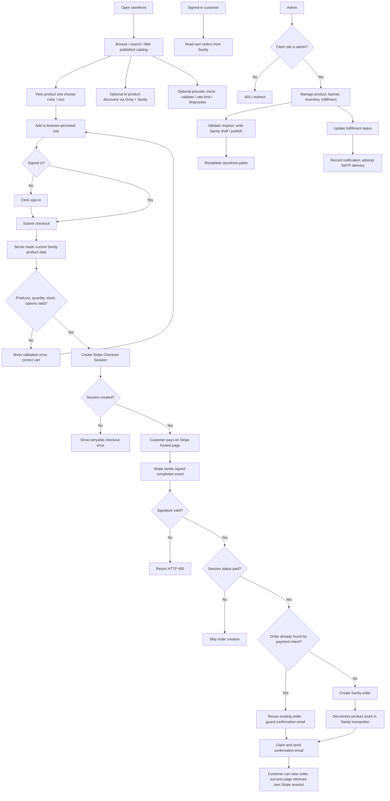

# Overall system flow

The paid order is created by the verified Stripe webhook, after payment confirmation. The customer return page retrieves the Stripe session and is not the order-creation trigger.

**Caption:** Storefront, payment, customer-order, admin, AI, and delivery-check paths. A4 landscape; this is a relatively broad overview and may be split into customer and admin pages for larger text.
