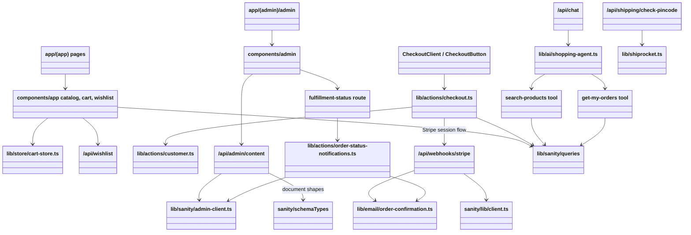

# Software module diagram

Modules below are actual routes, components, and function modules; the project is primarily React/function based rather than a set of domain classes.

**Caption:** Major application modules and dependencies. The Stripe webhook is invoked asynchronously by Stripe, not directly by the checkout action. A4 landscape recommended.
