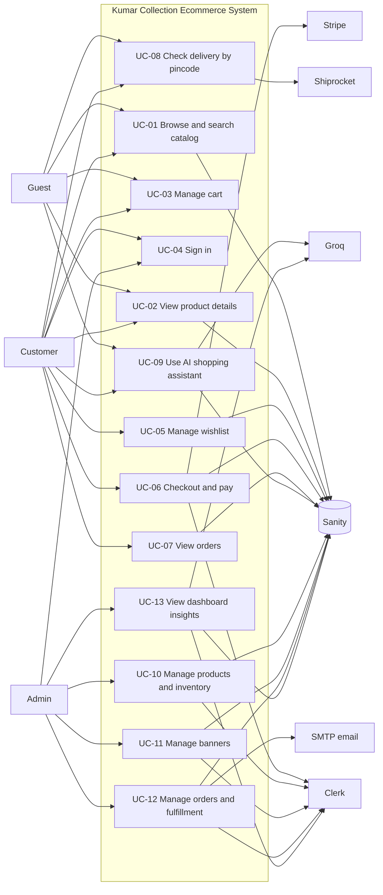

# Use case model

The diagram focuses on supported customer and administrator actions. Sanity, Clerk, Stripe, Groq, Shiprocket, and SMTP are secondary service actors.

**Caption:** Actor interactions inside the labeled application boundary. Guest cart means client-side cart operations; wishlist and checkout require sign-in. No UML include/extend relation is asserted.

## Actor and use-case dependency matrix

| ID | Use case and primary actor | Secondary actor(s) | Verified behaviour / limits |
|---|---|---|---|
| UC-01 | Browse/search — Guest, Customer | Sanity | Catalog and category browsing; search, category, fabric, color, size, fit, pattern, price, and sort controls exist. No stock filter control confirmed in storefront UI. |
| UC-02 | Product details — Guest, Customer | Sanity | Images, description, clothing attributes, stock, color and size selection. |
| UC-03 | Cart — Guest, Customer | — | Zustand persisted browser storage; add, remove, quantity, clear. No server persistence. |
| UC-04 | Sign in — Customer, Admin | Clerk | Clerk sign-in and protected routes; admin role uses `publicMetadata.role === "admin"`. |
| UC-05 | Wishlist — Customer | Clerk, Sanity | Authenticated API persists product references in a Sanity wishlist; revision-conflict retry. |
| UC-06 | Checkout/pay — Customer | Clerk, Sanity, Stripe | Server fetches canonical price/stock/options, requires authentication, creates Stripe Checkout session; signed webhook creates order and decrements stock. |
| UC-07 | View orders — Customer | Clerk, Sanity | Signed-in customer sees orders filtered by Clerk user ID. |
| UC-08 | Pincode check — Guest, Customer | Shiprocket | Six digits; in-memory rate limit 30 requests/5 min per observed IP, Shiprocket availability and ETA when supplied. |
| UC-09 | AI assistant — Guest, Customer | Groq, Sanity | Product search for all; order lookup tool only for signed-in users. |
| UC-10 | Products/inventory — Admin | Clerk, Sanity | Admin API validates allowed fields, drafts/publish/discard, image upload (4 MB cap), and blocks product deletion referenced by orders. |
| UC-11 | Banners — Admin | Clerk, Sanity | Admin content API supports banner create/edit/draft/publish/discard/delete and image upload. |
| UC-12 | Orders/fulfillment — Admin | Clerk, Sanity, SMTP | Status update and recorded status notification; retry endpoint exists for failed notifications. Unknown delivery outcomes are not blindly retried. |
| UC-13 | Dashboard insights — Admin | Clerk, Sanity, Groq | Sanity metrics and Groq-generated insights endpoint. |

**Print:** A4 landscape; the matrix may be placed on a separate portrait page.
